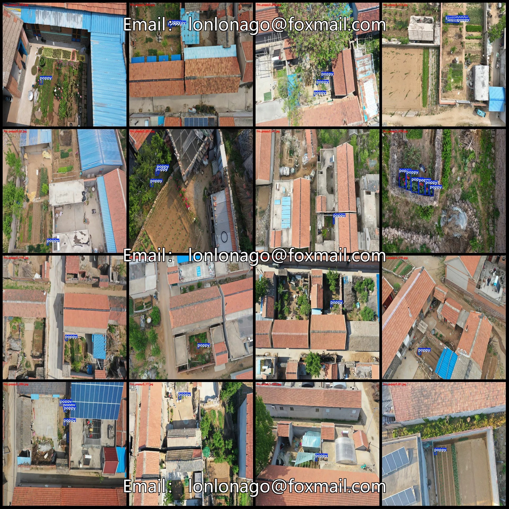
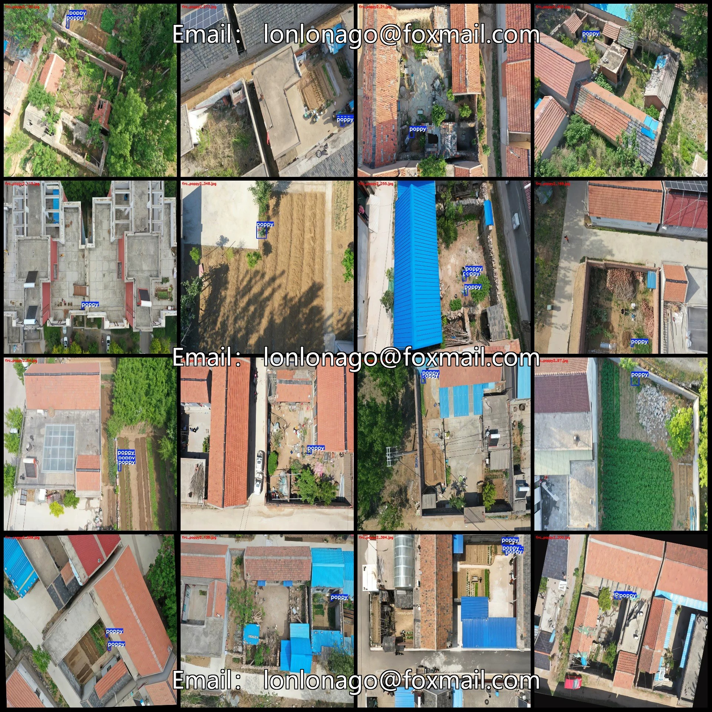
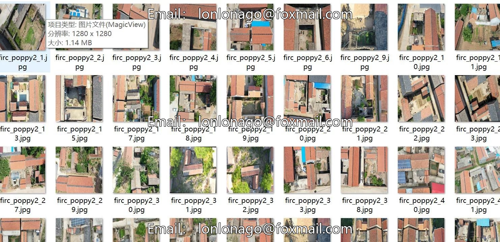
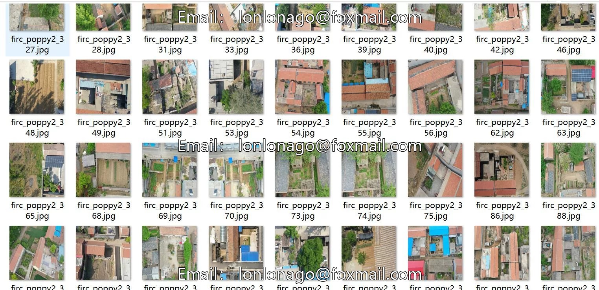
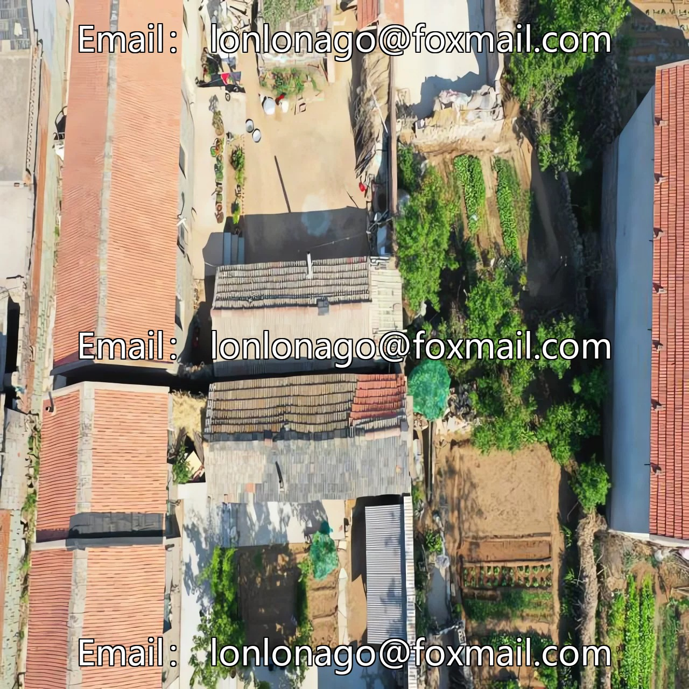

# Drone-view poppy detection dataset VOC+YOLO format with 342 images in 1 category

## Body

Drone-View Poppy Detection Dataset VOC+YOLO format: 342 images in 1 category
Dataset format: Pascal VOC format + YOLO format (txt file without split path, only containing jpg images and corresponding VOC format xml files and yolo format txt files)
Number of images (jpg file count): 342
Number of annotations (xml file count): 342
Number of annotations (txt file count): 342
Number of annotation categories: 1
Repository location: firc-dataset
Annotation category name: ["poppy"]
Number of bounding boxes per category
Poppy bounding box count = 660
Total bounding box count: 660

Number of images per category
Poppy has 342 images.
Image resolution: 1280x1280
Labeling tool used: labelImg
Labeling rules: Draw a rectangle around the category.
Important note: The dataset does not include splits for training, validation, or testing; you need to manually divide it.
Special statement: This dataset does not guarantee the accuracy of the trained models or weight files.

## Images

## Payment

Here is a pay link on Stripe ( https://buy.stripe.com/3cs8yP7sY87d0vu9AB ). Please contact me lonlonago@foxmail.com after funding $89, and I will send you a complete data files , thank you!

